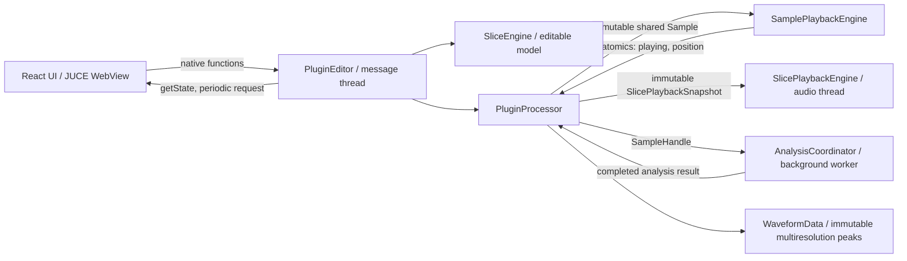
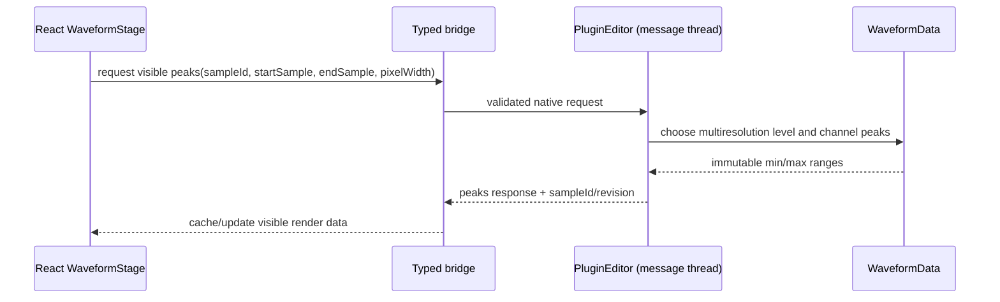

# Creative Sampler — UI-2.0A: Functional UI Architecture

**Статус:** архитектурный аудит и план; реализация UI не начата.<br>
**Основа визуального направления:** [exploration/DESIGN_SPEC.md](exploration/DESIGN_SPEC.md), направление B — Expressive Creative Instrument.<br>
**Объём аудита:** исходники `web-ui/src`, `src/plugin`, связанные UI, playback, analysis, sample и waveform типы, а также CMake-конфигурация.

## 1. Current Architecture

### Фактическая структура

| Область | Текущая реализация | Ответственность |
|---|---|---|
| Frontend | `web-ui/src/main.tsx`, `nativeBridge.ts`, `style.css` | Одно React-приложение; состояние, вызовы bridge, разметка и обработчики сосредоточены в `App` |
| WebView | `src/plugin/PluginEditor.cpp` | JUCE `WebBrowserComponent`, native function bindings, локальный resource provider |
| Processor | `src/plugin/PluginProcessor.cpp` | Sample import lifecycle, playback engines, `SliceEngine`, AnalysisCoordinator, публикация playback snapshot |
| Редактируемая модель слайсов | `src/slice/SliceEngine.*` | Message-thread модель слайсов и параметров |
| Playback | `src/playback/SamplePlaybackEngine.*`, `SlicePlaybackEngine.*` | Sample playback и MIDI-triggered slice voices; immutable sample/snapshot ownership |
| Waveform | `src/waveform/WaveformData.*` | Мультимасштабные min/max пики по каналам, построенные во время импорта |
| Native UI, оставшийся в редакторе | `src/ui/WaveformEditorComponent.*`, `SliceParametersPanel.*` | Waveform gestures, transient overlay, выбор слайса и native параметры; WebView размещается поверх компонентов на всё окно |

`CMakeLists.txt` запускает `npm run build` при конфигурации, включает `web-ui/dist/index.html` через `juce_add_binary_data` и компилирует WebView в plugin target. `vite-plugin-singlefile` встраивает JS и CSS в один HTML ресурс. Это обеспечивает локальную загрузку frontend без dev server и CDN.

### Данные и поток исполнения



Audio playback and analysis are native C++ responsibilities. React does not enter `processBlock()`. `SliceEngine` is edited on the message thread; the processor publishes new immutable slice snapshots for playback. The UI plan must preserve this separation.

## 2. Existing Feature Audit

The following status refers to the **current WebView experience**. A working native or audio-engine capability is not counted as WebView functionality if the WebView cannot use or display it.

| Функция | Статус в WebView | Фактическая реализация и канал | Ограничение |
|---|---|---|---|
| Sample Import | Работает частично | `importSample` вызывает native async file chooser; `PluginEditor` также принимает drag-and-drop файлов | Ошибки и loading пока сведены к строке `status`; web drag-and-drop не подключён самостоятельно |
| Sample Metadata | Работает | `getState`: filename, duration, sample rate, channels; данные берутся из `SampleMetadata` | Нет полного пути/битности, но для визуальной иерархии они не обязательны |
| Waveform | Работает ограниченно | `WaveformData` уже содержит мультимасштабные min/max пики по каналам; `webViewState()` выбирает уровень и сериализует фиксированные 256 значений `max(abs(min),abs(max))` только первого канала | Знак и stereo image потеряны; нет запроса уровня под фактическую ширину/zoom, минимум-максимум свёрнут в одну амплитуду; serialization повторяется при каждом state poll |
| BPM Detection | Анализ работает; UI показывает только часть результата | Все три анализатора автоматически запускаются после успешного импорта; `getState` отдаёт effective BPM только для completed результата | Нет статуса running/failed/insufficient, confidence, candidates, ambiguity и ручной коррекции; кнопка `ANALYZE SAMPLE` не подключена |
| Key Detection | Анализ работает; UI показывает только часть результата | completed, валидная тональность передаётся строкой | Нет confidence, альтернатив и ambiguity; нет отдельного UI-статуса недостаточности |
| Transient Detection | Анализ работает; визуализация в WebView отсутствует | В bridge передаётся только общее число событий | Позиции, strength/confidence не сериализуются; реальные transient markers отрисованы только native `WaveformEditorComponent`, скрытым WebView |
| Slice Selection | Работает, но состояние раздвоено | React вызывает `selectSlice(id)`; C++ устанавливает выбор в `WaveformEditorComponent`; список и waveform markers получают выбранный id из последующего `getState` | React также держит локальный `selected`; выбор хранится в editor-компоненте, не в `SliceEngine`; нет `sampleId` в команде |
| Slice Split | Работает ограниченно | `splitSlice` вызывает native `splitSelectedAtMidpoint()` для выбранного слайса | Только midpoint; нет drag-boundary editing в WebView |
| Slice Delete | Работает ограниченно | `deleteSlice` удаляет выбранный slice через `WaveformEditorComponent` | Команда не содержит ожидаемый sample identity / revision; удаление доступно лишь через ранее синхронизированное native selection |
| Slice Reset | Работает | `resetSlices` вызывает `SliceEngine::resetSlices()` через editor component | Результат операции не возвращается как типизированная ошибка; UI узнаёт результат только из полного нового state |
| Slice Playback | Audio engine работает; WebView-триггер отсутствует | `SlicePlaybackEngine` поддерживает MIDI Note On/Off и до 16 голосов; snapshot содержит границы, note и параметры | UI не предоставляет клавиатуру/триггер слайса; `playSample` запускает обычный Sample playback, а не выбранный Slice. Реальный MIDI зависит от host/input |
| Volume per slice | Работает | `editParameter(id, "volume", value)` вызывает `editSliceField`; новый snapshot публикуется процессором | Ответом служит полный state; нет revision/ack/error семантики |
| Pan per slice | Работает | Аналогично Volume | Та же неопределённость при устаревшей команде |
| Pitch per slice | Только отображается | Значение есть в C++ slice и сериализуется; диапазон/рендер есть в React | Bridge `editParameter` принимает только `volume`/`pan`; контрол редактирования отсутствует |
| ADSR | Только отображаются числа | Все четыре значения сериализуются из `SliceParameters`; native `SliceParametersPanel` имеет рабочие контролы под WebView | React не редактирует ADSR; график огибающей в функциональном WebView отсутствует |
| Master Volume | Audio parameter работает; WebView отображает фиктивное значение | APVTS `volume` и native slider attachment управляют громкостью playback | Native slider закрыт WebView; подпись `MASTER 0.0 dB` статична, команда/контрол в React отсутствует |
| Transport | Частично работает | `playSample` и `stopSample` управляют основным playback и voices; `playing` приходит в state | UI не использует `playing` для активного состояния; нет pause, кнопку Play не переключает |
| Playback Position / Playhead | В C++ и native waveform работает; в WebView отсутствует | processor предоставляет `playbackPositionSeconds()`; native editor обновляет WaveformEditor с частотой timer 30 Hz | `webViewState()` не включает позицию; WebView показывает статический `00:00.00` и декоративную полосу |
| Navigation tabs | Визуальные элементы | Три кнопки SAMPLE/SLICES/ANALYSIS в React | Нет смены рабочих областей или функциональных действий |
| Error / Loading states | Частично | import status передаётся строкой, import асинхронный | Не типизированы статусы анализа/bridge; нет явного bridge timeout/error/retry |

### Сводка по степени готовности

**Реально работают через WebView:** выбор файла через native chooser, sample metadata, 256-столбцовый waveform, выбор слайса, split midpoint, delete, reset, редактирование Volume/Pan, full-sample Play/Stop, строка import status, BPM/Key/transient count после завершённого анализа.

**Работают в backend или Native JUCE UI, но WebView не использует полноценно:** waveform multiresolution/stereo peaks, transient positions, slice boundary dragging, Pitch/ADSR editing, master volume control, playback position/playhead, активное состояние транспорта, MIDI slice triggering UI.

**Только визуальные или не подключённые элементы:** Analyze button, вкладки, позиция/прогресс транспорта, master volume text; Pitch/ADSR имеют реальные read-only цифры, но интерактивности нет.

**Отсутствуют:** отображение ошибок/статусов анализа с деталями, контекстные результаты confidence/candidates, web transient overlay, slice boundary drag, playback выбранного slice кликом/клавишей, редактирование Pitch/ADSR/Master Volume из React.

## 3. C++ Bridge Audit

### Нынешний протокол

`PluginEditor.cpp` регистрирует с `withNativeIntegrationEnabled()` native functions:

| Команда | Аргументы сейчас | Результат |
|---|---|---|
| `getState` | нет | Полный state snapshot |
| `selectSlice` | `sliceId` | Полный state после вызова |
| `editParameter` | `sliceId`, имя поля, число | Полный state после вызова |
| `importSample` | нет | Snapshot немедленно после открытия chooser; выбранный файл загрузится позже |
| `playSample`, `stopSample` | нет | Полный state после команды |
| `splitSlice`, `deleteSlice`, `resetSlices` | нет | Полный state после операции |

Frontend вручную воспроизводит протокол JUCE в `nativeBridge.ts`: `__juce__invoke` несёт `{ name, params, resultId }`, а `__juce__complete` разрешает Promise по `promiseId`. Результат команды — не отдельная структура ответа/ошибки, а такой же объект state.

### State payload

Сериализуются `sampleLoaded`, import `status`, `playing`, `file`, `duration`, `sampleRate`, `channels`, `selectedSliceId`, `analysisReady`, `bpm`, `key`, `transientCount`, массив `slices` (`id`, `start`, `end`, `note`, Volume/Pan/Pitch/ADSR) и `peaks`.

Отсутствуют: sample ID, model revision, analysis sub-statuses/confidence/alternatives, transient positions, playback position, waveform channel/min-max structure, command idempotency/error code. Slice/sample positions имеют sample-domain смысл, но payload не предоставляет явной версии sample metadata для привязки запроса.

### Частота, синхронизация и ошибки

- React запрашивает `getState` при mount и повторяет запрос каждые 700 ms. Каждая команда также возвращает полный snapshot.
- `requestSerial` отбрасывает ответ, если после старта запроса появился более новый вызов. Это защищает только frontend от позднего **ответа**, но не отменяет и не проверяет уже принятую C++ команду.
- При каждом poll C++ создаёт DynamicObject/Array и сериализует slice list и 256 peaks. Это message/UI-thread work, не audio-thread work, но неэффективно для частых обновлений позиции и может излишне сериализовать неизменные данные.
- Native обработчики обращаются к editor/model и JUCE UI APIs; они должны оставаться на message thread. `processBlock()` не вызывает WebView. Публикация PlaybackSnapshot обслуживается Processor timer, audio-thread читает immutable snapshot/atomics.
- Аргументы обрабатываются минимально: `editParameter` проверяет число аргументов и whitelist `volume`/`pan`; `selectSlice` приводит аргумент к целому. Нет общего schema validation, expected sample/revision или типизированного отказа.
- `editSliceField` получает текущий `engine.sampleId()` как expected sample уже после получения команды. Поскольку идентичность Sample не передана от UI, эта проверка защищает helper от внутреннего рассогласования, но не связывает команду с тем sample, на котором пользователь её инициировал.
- Bridge completion не имеет отдельного error callback/timeout. `callNative` возвращает `undefined`, если native backend отсутствует; pending Promise остаётся в Map, если completion не пришёл. UI это состояние отдельно не показывает.
- `getState` фильтрует анализ по текущему sample ID и статусу completed, поэтому старый analysis payload не показывается для нового Sample; bridge, однако, не передаёт identity/revision на frontend.

### Архитектурные риски, требующие решения до/во время интеграции

1. **Старые команды могут затронуть новое состояние.** Команды изменения/удаления не содержат ожидаемый `sampleId` и revision. Для будущего bridge добавить expected sample identity и проверять на message thread перед применением; ответ — accepted/rejected + свежий snapshot/revision.
2. **Два владельца selection.** React хранит `selected`, а C++ — выбор внутри `WaveformEditorComponent`; native Split/Delete опираются на это состояние. Новая архитектура должна иметь один владельческий слой для UI selection и передавать явные ID в команды редактирования. Selection — UI state, не SliceEngine domain state, но C++ обязан проверять ID в активном Sample.
3. **Слишком частые полные snapshots.** Нужны два вида обновлений: редкие/versioned domain snapshots и отдельный лёгкий transport event для position/play state. Позицию нельзя включать в большой payload с peaks.
4. **Bridge не типизирован по ошибкам и состояниям.** Нужны versioned DTO и конкретные коды результата (например, rejected stale identity, invalid argument, unavailable Sample, import failed), без показа неподтверждённого локального значения как истины.
5. **64-bit IDs в JavaScript.** В wire contract сериализовать `uint64` IDs как десятичные строки либо зафиксировать доказанный safe-integer диапазон; не терять точность в JS `number`.
6. **Дублирующийся Native UI под WebView.** PluginEditor создаёт JUCE controls и WaveformEditor, затем WebView получает полный bounds и `toFront`. При реализации новой поверхности нужно решить, какие native controls удалить/отвязать после функционального parity, чтобы не было скрытых side effects и двух путей редактирования.

## 4. Proposed React Component Architecture

Предлагаемая умеренно разделённая структура для `web-ui/src/`:

```text
src/
  app/
    App.tsx
    AppShell.tsx
    useSamplerState.ts
  bridge/
    juceBridge.ts
    protocol.ts
    validation.ts
  features/
    sample/SampleHeader.tsx
    waveform/WaveformStage.tsx
    waveform/WaveformCanvas.tsx
    waveform/SliceOverlay.tsx
    waveform/TimeRuler.tsx
    slices/SliceSequence.tsx
    inspector/SliceInspector.tsx
    inspector/AdsrEditor.tsx
    inspector/ParameterControl.tsx
    analysis/AnalysisSummary.tsx
    transport/TransportBar.tsx
    empty/EmptyState.tsx
    feedback/StatusNotice.tsx
  design/
    tokens.css
    typography.css
  styles/
    app.css
  main.tsx
```

Это предложение, не обязательная файловая нарезка: `ParameterControl`, `StatusNotice` и metadata row можно оставить внутри feature компонентов, пока нет повторного использования.

### Компонентная ответственность

| Компонент | Назначение / props | Данные и события | Зависимости / источник истины |
|---|---|---|---|
| `App` / `AppShell` | Сборка общей композиции B: header, waveform stage, contextual inspector, transport | `SamplerSnapshot`, UI view state; команды import, transport, selection | Только state hook и feature components; native snapshot владеет продуктовой моделью |
| `SampleHeader` | Sample identity, duration/rate/channels, Import и компактный analysis summary | Props из snapshot; `onImport` | Не вызывает bridge самостоятельно |
| `WaveformStage` | Главная область: waveform, time ruler, slice overlay, transient markers, playhead | waveform tile/peaks, sample identity/duration, slices, selection, playback position; selection, boundary edit gestures, optional viewport request | Canvas/SVG renderer; не читает аудиобуфер, не содержит business model |
| `WaveformCanvas` | Рендерит канал(ы) с min/max envelope на текущем viewport | Immutable visible peak data, dimensions, palette, playhead/selection overlay props | Canvas подходит для большого числа peak columns; resize обновляет только размер/LOD, не Sample |
| `SliceOverlay` | Отрисовывает sample-domain `[start,end)` границы, selected/active различие, transient marks | Sample rate/count, slice DTO, active voice notes если добавится событие | DOM/SVG overlay поверх canvas; pointer positions переводятся в sample coordinates только в UI, C++ валидирует границы |
| `SliceSequence` | Низкая полоса ориентации по фрагментам и быстрый выбор | Упорядоченные slice summaries, selectedSliceId; `onSelectSlice(id)` | Повторяет selection с waveform/inspector; не дублирует параметры |
| `SliceInspector` | Контекстные параметры выбранного slice | Selected slice DTO; `onParameterEdit(id, field, value, expectedIdentity)` | Показывается пустым/disabled без валидного выбранного ID; C++ подтверждает значение |
| `AdsrEditor` | ADSR controls и кривая, рассчитанная из четырёх подтверждённых значений | `EnvelopeParameters`; единичные edits | UI представление; любое применение проходит как native command и новая версия slice snapshot |
| `AnalysisSummary` | BPM/Key/Transient status, валидные значения и компактные детали | Полный типизированный analysis summary | Данные C++; не выводить BPM/Key до реального результата |
| `TransportBar` | Play/Stop, position, progress и master level | playback DTO; play/stop/master commands | Position поступает отдельным лёгким сообщением; waveform playhead использует ту же позицию |
| `EmptyState` | Импорт sample и понятное пустое состояние в той же композиции | import status/error | Без синтетической waveform или фиктивных результатов |
| `StatusNotice` | Loading/import/analysis/bridge error status | Typed status + error | Вторичная визуальная область, не перестраивает основной stage |

`main.tsx` остаётся bootstrap точкой (`createRoot`), а bridge не импортируется напрямую в renderer компоненты.

## 5. State Management

Для текущего масштаба отдельная Redux/Zustand зависимость не требуется. Предлагается небольшой типизированный bridge client и React reducer/store hook (Context добавлять только если props действительно начинают проходить через много уровней). В будущем можно заменить транспорт, сохранив feature props.

### Native State — авторитетные данные

Версионированный read model должен включать:

- `schemaVersion`, `sampleId`/identity, `stateRevision`;
- sample metadata (filename, duration, sample rate, channels, sample count);
- упорядоченные slices: string `id`, `startSample`, `endSample`, note и все параметры;
- BPM, Key и transients с независимыми status, результатами, confidence и валидными alternatives;
- playback: `isPlaying`, `positionSamples` или seconds + sample identity; master volume;
- import/operation state и типизированные ошибки.

UI не оптимистично меняет подтверждённые продуктовые данные. Во время жеста можно показать transient draft value, но commit отправляется в native, а финальное значение берётся из принятого snapshot. При частом control drag допускается coalescing последнего значения на message/UI стороне, если каждое применённое значение безопасно, а аудио Snapshot revision обновляется штатно.

### UI State — React владеет представлением

- выбранная вкладка/режим отображения, inspector раскрыт/свернут;
- `selectedSliceId` (контекст редактирования), hover, drag target/draft, focus;
- локальный zoom/scroll viewport и видимость вторичных метаданных;
- временные сообщения о pending-команде.

Selection остаётся UI state и валидируется относительно текущего `sampleId` и slice list. При смене sample или если slice удалён — выбрать первый существующий slice или `null`. React передаёт явно `sampleId + sliceId + expectedRevision` для операций над slice. Native отклоняет устаревший запрос и присылает актуальный state.

### Порядок синхронизации

1. WebView готов — запросить начальный versioned snapshot. Повторная загрузка страницы выполняет тот же handshake; backend ничего не ждёт и хранит актуальное состояние независимо от frontend lifecycle.
2. Принять snapshot только если schema валиден и revision не старее последнего принятого для того же sample. Новый sample identity сбрасывает локальные transient selection/hover/drag, viewport можно сбросить к целому sample.
3. Команда получает `requestId`, ожидаемую sample identity/revision и typed payload. Native ответ содержит `requestId`, status, новую revision и canonical snapshot либо ошибку.
4. Запоздалые completion применяются только к соответствующему request, но новый authoritative snapshot нельзя заменить данными меньшей revision.
5. Изменения sample/analysis/slices приходят через событие state-changed или через ограниченный контрольный запрос. Playback position публикуется отдельно с ограниченной частотой, целевой уровень порядка 20–30 Hz, только при открытом WebView.
6. `visibilitychange`/повторное открытие WebView запрашивает полный snapshot; пропущенные события не должны приводить к постоянному рассогласованию.

На первой реализации можно сохранить JUCE native function request/response как транспорт и добавить native-to-frontend state notifications через поддерживаемый JUCE 8 WebBrowser event API. Точные имена и ограничения callback/event нужно сверить в установленной JUCE 8 непосредственно перед кодированием; текущий `PluginEditor` push-событий не реализует.

## 6. Waveform Architecture

### Что уже есть

`WaveformData::generate()` строит мультимасштабные min/max пики **для каждого канала** во время импорта. `PluginProcessor` хранит `shared_ptr<const WaveformData>` отдельно от immutable `SampleStorage`. В native waveform уже есть sample-domain преобразование x↔sample, transient positions и playback position. Текущий WebView bridge намеренно упрощает данные до 256 абсолютных амплитуд первого канала.

### Предлагаемый read path



Bridge может отдавать min/max по L/R без передачи PCM. Для mono второй ряд каналов отсутствует/отражает mono presentation. `pixelWidth` и visible range ограничивают число передаваемых колонок; данные кэшируются в React по `sampleId + level/range + pixelWidth bucket`. Запрашивать их следует при смене Sample или viewport geometry/zoom, но не при каждом transport tick.

### Слои отображения

1. `WaveformCanvas`: waveform columns из min/max по каналам, общая временная ось. Визуальная стилизация берётся из `tokens.css` и разделов 3, 5, 6 DESIGN_SPEC.
2. SVG/DOM overlay: `[startSample,endSample)` slice bands/handles; selection и hover; transient events с sample positions; playhead.
3. Pointer interaction: canvas координата → видимый sample range → целый sample position. Zoom/scroll меняет только viewport mapping, не sample data и не реальные границы.

При плотных slices скрывать/сокращать подписи по измеренной ширине и правилам DESIGN_SPEC; не терять selection. При >16 слайсах поведение для подписей/ориентации остаётся design decision; архитектура должна поддержать viewport и компактную sequence, но не вводить новые функции Slice Engine.

### Bridge additions для Waveform

- sample identity и sample count;
- peaks response с min/max на канал, range/level metadata;
- все transient positions (не только count), strength/confidence и analysis status;
- playback position отдельно от peak/slice payload.

Новый DSP не нужен. Не переносить полную PCM копию в JS.

## 7. Design Specification Mapping

| Требование DESIGN_SPEC | Компонент | Источник данных | Реализация / ограничение | UI-2.0 этап |
|---|---|---|---|---|
| Visual identity, tokens, поверхности, типографика (разделы 1–3, 11) | `AppShell`, `design/tokens.css` | Документ спецификации | Переменные CSS + единая шкала; без сетевых шрифтов и карточного каркаса | 2.0B |
| Waveform — главный объект, без обычной карточки (раздел 2, 5–6) | `WaveformStage`, `WaveformCanvas` | Multiresolution waveform peaks | Свободная stage композиция; min/max, канал(ы), LOD по viewport; backend расширение | 2.0C |
| Sample identity и metadata (разделы 3, 4) | `SampleHeader`, `EmptyState` | Native metadata/status | Реальная информация, длинное имя ellipsis + полное значение через accessible title/tooltip | 2.0C |
| Slice границы, выбор, плотность 2–3 / 6–8 / 12–16 / >16 (раздел 6) | `SliceOverlay`, `SliceSequence` | Native slices + React selectedSliceId | Точные sample-domain координаты; UI density rules; границы требуют отдельной native validation command | 2.0D |
| Transient markers (раздел 6) | `SliceOverlay` | `TransientAnalysis.positions` | Позиция и статус из C++; текущий bridge передаёт только count | 2.0D / 2.0G |
| Inspector и selected-state linkage (раздел 7) | `SliceInspector` | Current slice DTO + UI selection | Контекстная область, без отдельной карточки на каждый параметр; пустое состояние | 2.0D |
| Volume / Pan / Pitch (раздел 7) | `ParameterControl` | Slice parameters | Подтверждённое значение из C++; Volume/Pan уже bridge-bound, Pitch требует whitelist+field mapping | 2.0E |
| ADSR controls и реальная кривая (раздел 7) | `AdsrEditor` | Envelope parameters | Кривая вычисляется из canonical ADSR, не декоративная; четыре безопасных native edits | 2.0E |
| BPM / Key / attacks и statuses (разделы 3, 4) | `AnalysisSummary` | Versioned AnalysisResult DTO | Показ only when valid; low-confidence/insufficient/running различимы; текущие альтернативы отсутствуют в UI | 2.0G |
| Transport, playhead, active playback (разделы 8–9) | `TransportBar`, `WaveformStage` | Playback state + throttled position event | Одна позиция синхронно в timeline и waveform; отдельный лёгкий transport update | 2.0F / 2.0G |
| Responsive 620×663, 900×686, 1440×900 (раздел 4) | `AppShell`, features | CSS container/window size | Сокращение вторичных facts перед уменьшением текста; C++ Editor min size сейчас 680×566, поэтому 620px spec размер пока недостижим через актуальное окно | 2.0H |
| Loading/error/empty/ready (раздел 10) | `EmptyState`, `StatusNotice` | Typed import/analysis/bridge status | Без фиктивной формы и фиктивных analysis results | 2.0C / 2.0G |
| Motion/feedback и акценты (разделы 5, 8–9) | `WaveformStage`, controls, transport | React interaction + native events | Только UI/message thread; никакой JS вызов из audio callback | 2.0B / 2.0H |

## 8. Migration Plan

Сохранять текущую рабочую версию и переносить функции небольшими проверяемыми шагами. До каждого этапа фиксировать базовый build/bridge smoke check; изменения функционального UI не смешивать с exploration.

| Этап | Цель / файлы | Зависимости | Критерии готовности и тесты | Риски |
|---|---|---|---|---|
| **UI-2.0B — Design System & Component Foundation** | Создать tokens, типы UI DTO, AppShell и структуру features. Новый экран может быть скрыт за временным dev/build switch или собираться параллельно; текущий функциональный screen остаётся fallback. | DESIGN_SPEC; без изменения audio engine | Production Vite build; strict TS; snapshot/DTO parser tests; визуально проверить пустое/загруженное состояния и основные viewport | Переключатель эксперимента не должен попасть в production API; избегать миграции всего entry point разом |
| **UI-2.0C — Main Layout & Waveform** | Header, Empty/Loading/Error, waveform stage, metadata; добавить versioned metadata/peaks query | 2.0B; уточнённый waveform DTO | Native/TS contract tests; mono/stereo и sample switch; сравнить peaks с `WaveformData`; проверить отсутствие PCM duplication | Объём событий/пиков, LOD на HiDPI, stereo layout |
| **UI-2.0D — Slice Visualization & Inspector shell** | Slice overlay/sequence, selection state, пустой inspector; добавить expected sample identity/revision и явные IDs mutation commands | 2.0B–C; bridge identity contract | stale sample/slice command rejected; selection переживает resize, сбрасывается при смене Sample, совпадает в waveform/sequence/inspector; boundary-coordinate unit tests | Сейчас selection привязан к native editor; native split/delete API опирается на selection implicit |
| **UI-2.0E — Controls & Parameter Binding** | Volume, Pan, Pitch, ADSR controls, curve | 2.0D; field validation и ack DTO | Тесты диапазонов/форматирования/ack; Rapid drag coalescing; verify новые snapshots для следующих voices, уже звучащие не меняются | Расхождение model revisions; неверное отображение подтверждённого/чернового значения |
| **UI-2.0F — Transport & Playback States** | Play/Stop, master level, real playhead, active/selected distinctions | 2.0C/D; playback-position message path | position monotonic/reset/sample change tests; update ограниченной частоты; no full snapshot per tick; проверка активных Slice vs selected | Текущий `playbackPositionSeconds()` относится к SamplePlaybackEngine, MIDI slice voices не публикуют transport position; нужен ясный playback-position contract |
| **UI-2.0G — Full Bridge Integration** | Объединить DTO/events/errors/import/analysis/transients; удалить фиктивные handlers и статические placeholders | 2.0C–F; bridge schema version | Интеграционные tests для import/error/new sample/stale requests/reload; BPM/Key statuses, transient positions; повторный WebView handshake | Payload backwards compatibility; events во время уничтожения/recreation WebView |
| **UI-2.0H — Responsive, Polish & Regression** | Завершить responsive rules, accessibility, motion, performance и убрать дублирующие скрытые native controls после parity | Все предыдущие | Production build; strict TS; CTest; manual standalone; plugin editor smoke; проверка 620×663, 900×686, 1440×900, high DPI, long names/dense slices; проверить main screen fallback until accepted | Native min editor bounds надо согласовать с 620 px spec; тесты DAW/platform требуют реального окружения |

### Условие сохранения рабочего UI

До приёмки нового экрана текущий WebView остается доступным как fallback. Предпочтительна узкая feature/build-time switch или отдельный dev route, не пользовательская навигация и не параллельная бизнес-модель. Переключение на новый экран — отдельное явное решение после функционального parity и smoke test; удаление fallback — только позже и отдельным изменением.

## 9. Risks and Dependencies

### Критические

1. **Sample identity отсутствует в WebView DTO и mutation arguments.** Перед boundary-editing и любым slice operation добавить проверку `sampleId`/revision в native handler; это минимальная необходимая bridge-эволюция, SliceEngine менять не требуется.
2. **Playback-position для slice voices не определён.** Sample engine публикует position, но MIDI SlicePlaybackEngine публикует только voice count. Нужно решить в UI-2.0F: один глобальный cursor показывается для sample playback, а slice playback получает активный fragment state без обещания единственного playhead; либо определить агрегированное отображение отдельно.
3. **Waveform bridge слишком lossy для выбранного дизайна.** Нужна channel-aware min/max peak query и transient event positions, но не изменение DSP/engine.
4. **Editor minimum size сейчас 680×566.** Спецификация тестировалась с 620px шириной; проверить и, если потребуется, минимально изменить `setResizeLimits` в последующей реализации. Для UI-2.0A менять нельзя.
5. **Автоматический полный state poll.** Полный payload нельзя использовать как high-rate transport stream; события и данные разной частоты нужно развести.

### Средние

- Resource provider сейчас возвращает один single-file HTML и игнорирует requested path. Изменение Vite single-file/resource packaging не нужно для текущего экрана, если всё остаётся inline; при локальных изображениях/шрифтах понадобится расширить встраивание и provider.
- CMake reconfigure запускает npm build, поэтому UI-итерация имеет npm/toolchain как обязательную build dependency.
- Native controls и Native WaveformEditor по-прежнему создаются под WebView, хотя визуально закрыты им. Сохранять их до функционального parity, но проверить их callbacks/side effects при удалении.
- Поддержка WebView2 объявлена через `NEEDS_WEBVIEW2 TRUE`; фактическую Windows smoke проверку нельзя выводить из macOS build.
- Frontend не имеет тестового runner в `package.json`; bridge protocol и pure formatting/state reducer можно покрыть unit tests на UI этапе без добавления тяжёлой инфраструктуры.
- Текущий `nativeBridge.ts` хранит Promise callbacks без timeout и не очищает их при закрытии frontend. При новом client добавить timeout/cleanup, не маскируя bridge offline как валидный пустой Sample.

## 10. Unresolved Decisions

Рекомендации учитывают раздел 13 `exploration/DESIGN_SPEC.md`.

| Вопрос | Рекомендация | Обоснование | Когда утвердить |
|---|---|---|---|
| Selected vs active slice | Selection принадлежит React UI; active voices — отдельное playback состояние native. Показывать selected и active разными, не конкурирующими маркерами. Сейчас playback engine может иметь несколько voice одновременно | Выбранный объект инспектора не обязан совпадать с нотой, звучащей из MIDI | До UI-2.0D/F; базовое разделение state заложить в 2.0B |
| Более 16 слайсов | Не менять SliceEngine; в UI скрывать часть подписей по ширине, сохранять все границы и выбранный фрагмент; позднее отдельно решить zoom/scroll или sequence navigation | >16 — presentation problem; текущий дизайн только визуально определяет правила до 16 | До polish 2.0H, после прототипа на фактической плотности |
| Минимальная типографика в 620px | Скрывать вторичные facts/подписи и переводить inspector в более плотную компоновку раньше, чем снижать размер основного числового значения. Зафиксировать минимумы по читаемости на реальных скриншотах | Текущая спецификация отмечает мелкие ADSR/технические метки; window C++ сейчас min width 680 | В 2.0B/C экспериментировать; окончательно перед 2.0H и решить editor resize constraint |
| Параметры и ADSR | Использовать SliceParameters как единственный источник; добавить bridge edit/ack для Pitch и ADSR; кривую строить из подтверждённых A/D/S/R | C++ уже содержит и DSP применяет параметры; WebView принимает только Volume/Pan | До реализации инспектора 2.0E |
| Playback position | Для Sample playback использовать опубликованные seconds/sample position; для polyphonic slice voices пока отдельно показывать факт active voices/последний активированный slice, не рисовать один неверный cursor для нескольких голосов. Если нужен voice cursor — проектировать voice event позже | Одновременно могут звучать до 16 голосов, общего музыкально корректного playhead у polyphony нет | До 2.0F; architecture DTO field можно включить позднее |
| Сохранённые UI-1.5 screenshots | Они не являются архитектурным блокером; оставить отсутствующими, не генерировать placeholders | DESIGN_SPEC фиксирует отсутствие сохранённых PNG, но визуальные правила и размеры описаны | Перед визуальным sign-off/implementation review, если нужна file-based approval |

### Ответы на вопросы перед стартом

- **Достаточно ли C++-архитектуры для дизайна B?** Для основной композиции, sample metadata, Slice model, current audio playback и параметров — да. Для точной waveform, transients, transport position, типизированных analysis states и stale-safe редактирования WebView bridge требует расширения.
- **Какие изменения bridge действительно необходимы?** Versioned DTO с sample identity/revision; явные expected identity для mutations; typed operation results; stereo/min-max waveform query; transient positions и analysis statuses; Pitch/ADSR/master volume commands; лёгкие playback events. Не требуется менять SampleEngine, SliceEngine или DSP.
- **Можно ли начинать UI-2.0B без риска переписывания аудиодвижка?** Да. UI-2.0B можно вести параллельно на DTO/mock boundary и design tokens, сохраняя текущий экран. До 2.0C/D специфицировать только небольшой adapter в PluginEditor/Processor; аудио ownership и `processBlock()` остаются нетронуты.
- **Что утвердить до реализации?** Два архитектурных решения: (1) wire identity/revision и string representation 64-bit IDs; (2) playback-position модель для одновременных polyphonic Slice voices. Остальное допустимо уточнять на визуальных шагах 2.0B–H.

## 11. Проверка фактов и ограничений аудита

- Аудит сделан по исходникам, а не только README или предыдущему отчёту. Главные точки входа: `web-ui/src/main.tsx`, `web-ui/src/nativeBridge.ts`, `src/plugin/PluginEditor.cpp`, `src/plugin/PluginProcessor.cpp`, `src/waveform/WaveformData.*`, `src/ui/WaveformEditorComponent.*`, `src/ui/SliceParametersPanel.*`, `src/slice/SliceEngine.*`, `src/playback/*`, `src/analysis/AnalysisTypes.h`.
- C++ WebView регистрирует только перечисленные выше native functions. Push state notifications в исходном `PluginEditor` не обнаружены.
- `withResourceProvider` игнорирует path и возвращает embedded `index_html`; это соответствует single-file Vite build.
- В этой фазе меняется только этот Markdown-документ. Код, bridge, frontend, CMake, DSP и audio engine не изменяются.
- C++ build/tests не запускались: документирование не меняет код; дальнейшая реализация должна выполнить проверки, указанные для каждого этапа.

## 12. Рекомендуемый следующий шаг

Начать UI-2.0B: зафиксировать tokens из DESIGN_SPEC, добавить минимальные типы и UI state model, создать shell/empty-state и waveform/inspector layout в параллельной реализации, оставив текущий экран доступным fallback. В том же подэтапе согласовать wire DTO identity/revision и проверить точный JUCE 8 mechanism для native-to-frontend event delivery, не подключая пока высокочастотный transport и не меняя audio engine.
