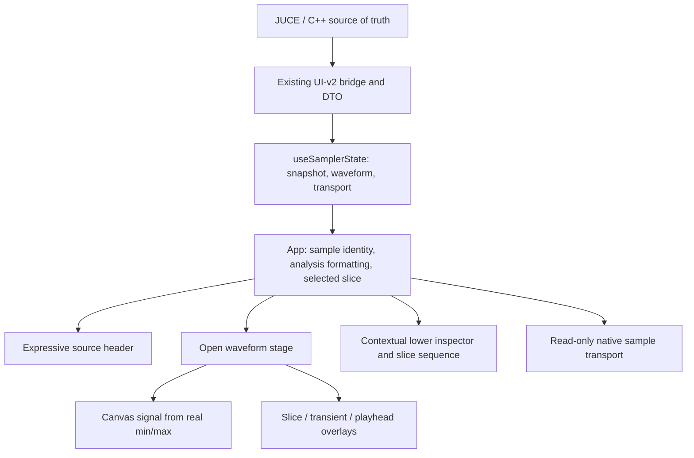

# UI-2.2A — Аудит Expressive и план переноса

## 1. Краткий вывод

Expressive — визуальный источник истины для будущего production UI. Это не набор отдельных цветов и контролов: его отличает открытая, почти бесшовная композиция, в которой waveform занимает сцену, а инспектор и транспорт собраны в нижнюю инструментальную полосу. Production UI-v2 уже имеет реальные данные и рабочий read-only мост, но организован как привычный экран приложения: шапка, отдельная область waveform с временной шкалой и последовательностью слайсов, инспектор и транспорт.

Перенос следует выполнять внутри React UI-v2, сохраняя текущие DTO, bridge и C++ движки. Основная работа — заменить композицию и визуальные слои Waveform/Inspector/Transport; адаптер данных в `App.tsx` сохранить. Реальные данные не требуют добавления демонстрационных слайсов или новой модели состояния. Самое существенное продуктовое ограничение: текущий bridge не предоставляет сведения об активных MIDI voice, поэтому Expressive можно точно связать с реальной позицией обычного sample playback, но нельзя достоверно подсвечивать реально звучащий slice от MIDI.

Этот документ фиксирует аудит и план, а не объявляет дизайн перенесённым. Код интерфейса, bridge и движка в UI-2.2A не изменялись.

## 2. Источники и границы проверки

Проверены исходники Expressive и его спецификация, компоненты и стили UI-v2, bridge DTO и реализация JUCE native functions. Exploration открыт в браузере по `http://127.0.0.1:5178/#expressive` и визуально проверен в компактном viewport 620×663 для состояний Minimal Sample, Dense Sample, Transient Heavy, Metadata Heavy и Active Performance.

Для размеров 900×686 и 1440×900 в этой проверке использованы документированные правила и предыдущие наблюдения в `web-ui/exploration/DESIGN_SPEC.md` и CSS media/layout rules; отдельный новый браузерный рендер этих размеров в ходе данного аудита не выполнялся. В DESIGN_SPEC также указано, что скриншоты осматривались в трёх размерах, но PNG-файлы не были сохранены. Поэтому ниже визуальные наблюдения текущего аудита при 620 px отделены от ранее записанной responsive спецификации.

Основные исходники:

| Область | Фактические файлы |
|---|---|
| Expressive composition and scenarios | `web-ui/exploration/main.tsx` |
| Expressive styling and breakpoints | `web-ui/exploration/styles.css` |
| Visual rules and prior viewport review | `web-ui/exploration/DESIGN_SPEC.md` |
| Production screen composition | `web-ui/src-v2/app/App.tsx`, `app.css` |
| Production waveform | `web-ui/src-v2/app/Waveform.tsx` |
| Production inspector | `web-ui/src-v2/app/Inspector.tsx` |
| Production transport | `web-ui/src-v2/app/Transport.tsx` |
| Native state and waveform lifecycle | `web-ui/src-v2/app/useSamplerState.ts` |
| DTO contract and view types | `web-ui/src-v2/bridge/protocol.ts` |
| JUCE callbacks, serialization, publication, resource-backed WebView | `src/plugin/PluginEditor.cpp`, `src/plugin/PluginEditor.h` |
| Build switch and embedded UI targets | `CMakeLists.txt` |

## 3. Анализ Expressive

### 3.1 Композиция и ритм

В продуктовой композиции нет постоянно видимой боковой навигации и набора равноправных карточек. Верхняя полоса — это идентичность источника: знак, крупное имя сэмпла, техническая строка и группа фактов/инструментов. Под ней открыт stage. Waveform занимает около 49% высоты stage, начинается примерно на 23% его высоты; временная шкала находится у нижнего края рабочей сцены. Нижняя полоса инспектора закреплена над транспортом. В ней контекст Slice, ADSR, основные параметры и последовательность фрагментов прочитываются как части одного инструмента.

В CSS это выражено явными размерами: header 143 px, stage с боковым полем 52 px, inspector 154 px, transport 66 px; при коротком окне header 104 px, inspector 176 px. На ширине до 700 px поля stage сокращаются до 12 px, заголовок сжимается до 104 px, а инспектор перестраивается в четыре компактные смысловые колонки. Эти размеры относятся к исследовательской композиции; при переносе их нужно сверить с реальным размером WebView и минимальным размером редактора.

### 3.2 Waveform, фрагменты и анализ

Waveform — ряд тонких вертикальных амплитудных штрихов на центральной временной оси; он не помещён в рамку-карточку. Фон сцены может иметь широкое малоконтрастное цветовое поле, но сигнал остаётся главным. Выбранный интервал читается непрерывной полупрозрачной заливкой и двумя краями; соседние границы тоньше. Playhead — отдельная светлая линия поверх waveform. Transient markers янтарные, тонкие и тише сигнала; в transient-heavy сценарии их opacity намеренно снижается.

Подписи зависят от плотности: при 2–3 слайсах видны названия/ноты, при 6–8 — подписи остаются читаемыми, при 12–16 в waveform остаются преимущественно номера, а список слайсов становится компактной последовательностью. В проверенных состояниях Dense и Transient Heavy на 620 px визуализация насыщенная, но выбор и границы остаются различимыми; мелкие вспомогательные подписи уже близки к нижнему пределу читаемости. Более 16 фрагментов спецификация считает нерешённым сценарием.

### 3.3 Inspector, контролы и транспорт

Inspector не похож на ряд одинаковых карточек: четыре зоны различаются ролью и масштабом — выбранный фрагмент, кривая ADSR со значениями, компактные Volume/Pan/Pitch и последовательность slice. Volume показан дуговым индикатором, Pan — осью L/C/R, Pitch — линейным контролом. У элементов есть состояния выбранного/наведения, но исходный прототип не обеспечивает доменную редактируемость этих параметров.

Transport — небольшая нижняя полоса с Play/Pause, Stop, временем, прогрессом и Master. В Active Performance playhead движется и Play меняет вид. Это намеренно локальная демонстрация: время, движение и значения контролов не подтверждены аудиодвижком.

### 3.4 Палитра, типографика, поверхности

CSS задаёт графитовый фон `#111118`, текст `#efedf5`, приглушённую подпись `#9792a4`, violet `#b59cf4`, mint `#72d9ca`, pink `#d38bbb` и amber `#d7aa7b`. Цвет используется для различения ролей и состояния, а не как независимый декор. Поверхности различаются главным образом тоном и мягким градиентом; рамки ограничены тонким разделением верхней и нижней зон.

Используются локальные системные семейства Arial/Helvetica и моноширинные системные fallback для технических данных. Крупный sample title — первый типографический акцент, технические подписи компактны и разрежены. В узком режиме часть брендовой подписи и вторичных фактов скрывается, а длинные данные обрезаются контролируемо.

### 3.5 Что в Expressive является только визуальной демонстрацией

В `main.tsx` сценарии, waveform peaks, границы, transient positions и анализ — статические mock data. Waveform рисуется SVG `line`; выбор slice — локальное состояние страницы; playhead — CSS animation; время в transport не является аудио-позицией. ADSR-форма и её значения заданы демонстрационно, как и Volume/Pan/Pitch; импорт не подключён к native picker. Stress selector A/B/C/E — инструмент исследования, не продуктовая навигация.

Следствие: переносится художественный язык и поведение отображения, но все значения, позиции и статусы должны поступать из UI-v2 DTO. Нельзя переносить mock constants, фиктивную анимацию, фиктивный импорт или сам переключатель сценариев в product UI.

## 4. Аудит production UI-v2

### 4.1 Композиция и компоненты

`App.tsx` строит экран из `cs-sample-header`, `Waveform`, `Inspector`, `Transport`. `app.css` задаёт grid строками header / waveform / inspector / transport и медиаправила. При узком окне остаётся та же вертикальная схема, но уменьшаются колонки и контролы. Waveform имеет отдельный stage background, заголовок, note ruler, plot, time ruler и sequence. Инспектор ниже waveform содержит идентичность слайса, SVG ADSR и три RotaryControl. Transport занимает нижнюю строку.

Из имеющихся частей технически полезны типографические примитивы, Button/IconButton, RotaryControl, transient primitive и форматирование значений. Они не обязаны сохранить своё текущее расположение или размеры. `Waveform.tsx`, `Inspector.tsx`, `Transport.tsx` имеют понятные границы компонентов, но вероятно потребуют существенной визуальной переработки. Композицию `App.tsx` и grid `.cs-app-shell` потребуется заменить, а не косметически подстроить.

### 4.2 Реальные функции и данные

Production UI-v2 уже подключён к настоящему backend:

| Функция | Подтверждённая реализация и текущая граница |
|---|---|
| Sample import | Header вызывает `nativeBridge.importSample()` → JUCE `importSampleV2`; native file chooser/импорт уже существуют. UI отображает loading/error из snapshot, но completion открытия chooser не равен завершению импорта. |
| Sample metadata | Реальные `fileName`, `durationSeconds`, `sampleRate`, `sampleCount`, `channelCount`, `bitDepth`, `sampleId/revision`; App форматирует заголовок и техническую строку. |
| Waveform | `getUiV2Waveform` возвращает компактные min/max buckets по отдельным каналам; UI запрашивает до 2048 buckets/канал и рисует Canvas с ResizeObserver. Это display summary, не PCM. Повторный запрос происходит при смене sample; state-защита проверяет sample identity. |
| Slice state/selection | Snapshot несёт stable ID, `[startSample,endSample)`, MIDI note и параметры. `App` создаёт view mapping и держит выбранный ID локально в React; сбрасывает выбор при смене sample/если ID исчез. На waveform кликом выбираются slice и sequence item. |
| Split/Delete/Reset в UI-v2 | Не подключены к новому UI. C++ native functions в PluginEditor существуют для старой/legacy поверхности, но UI-v2 не должен показывать их как рабочие команды до отдельного этапа. |
| BPM/Key/transients | Реальные `AnalysisDto`: статусы notAnalyzed/running/completed/failed/cancelled; при completed доступны BPM, key и реальные sample-domain transient positions/strength. App фильтрует данные по текущему sample. |
| Slice parameters | Volume, Pan, Pitch и ADSR приходят в Slice DTO; Inspector визуализирует их только для чтения. Изменение параметров через UI-v2 не подключено. |
| ADSR | SVG в `Inspector.tsx` строит форму из Slice параметров; подписи значений динамические. ARIA-описание всё ещё говорит «Демонстрационная форма ADSR» и должно быть исправлено в фазе реализации. |
| Sample transport | Snapshot и отдельные transport updates дают status и позицию обычного sample transport. UI двигает playhead и прогресс из native данных; кнопки Play/Stop сейчас disabled/read-only. |
| MIDI slice playback | Engine запускает Slice voices через MIDI отдельно от sample transport. UI-v2 не получает список активных voices/ID и не может достоверно подсветить играющий MIDI slice. `activeVoices` в текущем `protocol.ts` равен `null`. |
| Fallback | Старый Native JUCE UI остаётся в `PluginEditor`; выбор WebView v2 и legacy URL управляется build definition `CREATIVE_SAMPLER_USE_UI_V2`. Текущая задача не должна менять этот fallback. |

### 4.3 Bridge и владение состоянием

Фактическая интеграция UI-v2 использует `web-ui/src-v2/bridge/nativeBridge.ts`, `protocol.ts` и `app/useSamplerState.ts`. Native callbacks регистрируются в `src/plugin/PluginEditor.cpp`; snapshot публикуется через `samplerStateSnapshot`, транспорт — отдельным `samplerTransportUpdate`. Waveform запрашивается отдельно по sample ID. Snapshot содержит монотонную `sequence`; React отбрасывает устаревшие snapshot/transport ответы и проверяет sample ID для waveform и транспорта. Fallback refresh выполняется раз в 5 секунд и при возврате окна в фокус. Не нужно заменять эту синхронизацию состоянием из exploration.

C++ остаётся источником истины для sample, waveform summary, analysis, slice-параметров, playback. React владеет выбранным slice ID и только локальным UI state. UI визуально может показывать selection; он не должен называть его реально активным голосом без native telemetry.

## 5. Сопоставление Expressive → production

| Expressive design / исходник | Production сейчас | Действие для переноса |
|---|---|---|
| Полотно без dashboard-колонок: `.expressive`, `.expressiveHeader`, `.expressiveStage` в `exploration/styles.css` | Grid `.cs-app-shell`: Header → обычная waveform section → Inspector → Transport | **Заменить композицию.** Перестроить `App.tsx`/`app.css` в Expressive hierarchy: source header, открытый stage, единый нижний inspector, anchored transport. Не сохранять текущие размеры только по инерции. |
| Бренд и source identity; крупный sample name и сдержанная tech строка | `cs-product-mark`, `cs-sample-identity`, import button, метаданные | **Адаптировать.** Сохранить реальное имя/факты и Import callback, переместить их в Expressive header. Длинное имя ellipsis/scale как предусмотрено CSS; не терять sample identity. |
| BPM/Key/facts в тихой зоне header (`sampleFacts`) | Три правые analysis columns: Tempo, Key, Attacks | **Адаптировать.** Использовать реальные статусы и результаты. В `running/notAnalyzed/failed` не показывать фиктивные числа; вторичные facts скрывать/сжимать на узком viewport. |
| Waveform занимает открытую сцену, SVG-штрихи, мягкая осевая линия | Canvas min/max по каналам внутри `.cs-main-waveform` stage; реальные peaks | **Визуально заменить, данные сохранить.** Оставить min/max, stereo lanes, DPR cap и ResizeObserver. Изменить presentation на плотный, выразительный signal, соразмерный Expressive. Не передавать PCM и не вычислять waveform в React. Проверить, как стилистика работает для mono/stereo и различной динамики. |
| Slice selection: непрерывное tint-поле, заметные края, labels адаптированы к плотности | `.cs-slice-region` overlay с selected tint; click selection; note ruler и отдельная sequence grid | **Переработать overlay и интеграцию.** Slice ranges по-прежнему вычислять из sample-domain `[start,end)` и `sampleCount`. Перенести полупрозрачную полосу/края и density rules. Sequence визуально включить в нижнюю инструментальную композицию; selection остаётся локальным React state и синхронным с inspector. |
| Transients — приглушённые янтарные метки поверх сцены, плотность снижает opacity | Реальные `ViewTransient`, `.cs-transient`, отдельный `TransientMarker` | **Сохранить источник данных, адаптировать отрисовку.** Зафиксировать sample-domain alignment, на высокой плотности управлять контрастом/видимостью, не скрывая выбранные boundaries/playhead. Mock marker generation не переносить. |
| Playhead — тонкий светлый вертикальный индикатор | `.cs-playhead`, позиция из actual sample transport | **Сохранить semantics, переделать стилистику.** Использовать native position и sample count; не включать декоративную непрерывную CSS-анимацию вместо native state. Транспорт и waveform должны показывать одну позицию. |
| Ruler интегрирована в край сцены | Отдельная time ruler под plot плюс note ruler над plot | **Адаптировать/объединить.** Сохранить корректную временную шкалу, сократить визуальный вес. Не дублировать note labels и sequence labels без пользы. |
| Нижний inspector: Slice identity, envelope, Volume arc, Pan axis, Pitch control, sequence | `Inspector.tsx`: identity, ADSR, три rotary; sequence остаётся в `Waveform.tsx` | **Пересобрать структуру и визуальные типы.** Перенести sequence внутрь нижней composition; сохранить настоящие параметрические значения. Реализовать отдельные Volume/Pan/Pitch визуальные формы из Expressive только как read-only presentation на этом этапе. Не копировать значения mock. |
| ADSR curve и четыре компактных значения | Динамический SVG curve/цифры по Slice DTO, но generic panel and labels | **Адаптировать, не ломая вычисления.** Использовать реальные Slice DTO и корректную подпись доступности; сверить отображение нуля, 10 s, sustain 0/1, коротких атак и нормализацию кривой. |
| Play/Pause, Stop, time, progress, master in compact footer | Реальный read-only sample transport; Play и Stop пока disabled; Master control в UI-v2 нет | **Сохранить отображение текущего состояния.** Стиль футера может соответствовать Expressive. Оставить кнопки disabled до команды/подтверждения backend. Не переносить fake Master values или обещать управление. |
| Compact/metadata/transient/empty/performance states | Реальные Empty/loading/analysis/error/sample смена; нет отдельных exploration сценариев | **Связать дизайн с реальными статусами.** Разработать Empty, Loading, Analysis состояния и длинные имена в том же дизайне; не подключать stress selector и не отображать фиктивный sample. |
| Hover/selected/playing states в исследовательском CSS | Waveform selection и control hover есть; sample playback активность state есть; active MIDI slice недоступен | **Адаптировать только достоверные состояния.** Selected = выбран для инспектора; Playing = sample transport. Active MIDI voice оставить неотображённым до расширения telemetry. |
| Статическая сцена A/B/C/E и test selector | Нет в product App; Showcase отделён | **Не переносить.** Сохранить exploration A/B/C и Showcase UI-2.0B отдельно. |

## 6. Целевая архитектура переноса

Для первой миграции не требуется менять DTO, `nativeBridge`, `useSamplerState`, C++ callbacks или аудиодвижок. Разделение ответственности предлагается сохранить следующим:

Рекомендуемая ответственность компонентов после UI-2.2B:

| Область | Ответственность | Переиспользовать |
|---|---|---|
| `App.tsx` | Bridge subscription, derived real data, выбранный slice, sample смена, top-level statuses | `useSamplerState`, `protocol.ts`; не помещать сюда waveform drawing |
| Source header (компонент внутри `app/`) | Имя/метаданные, analysis facts, Import с существующим native command | Button, Typography; реальный snapshot |
| Waveform stage | Геометрия открытой сцены, временная ось, layout signal и overlays | `WaveformProps`, actual metadata/peaks |
| Signal renderer | Реальные min/max по каналам, responsive redraw | Текущий Canvas + ResizeObserver предпочтительно сохранить как renderer; менять только стиль |
| Slice overlay | Выбранное/обычное состояние границ, labels по плотности, выбор ID | `ViewSlice` sample positions; существующие selection callback |
| Analysis overlay | Transients, плотность/контраст | `ViewTransient`, `TransientMarker` возможно стилизовать |
| Context inspector | Selected identity, ADSR visualization/value, Volume/Pan/Pitch, slice sequence | Существующий envelope computation и данные; `RotaryControl` технически необязателен, поскольку Expressive использует различные формы |
| Transport | Native sample play state/time/progress; disabled controls пока нет команд | `Transport` props и real native transport updates |
| Empty/loading/error | Native app/sample/analysis status без поддельной формы | Существующий status model и import error paths |

Это логические зоны, не требование немедленно дробить компоненты на множество файлов. Если существующие компоненты сохраняют полезные границы, можно менять их markup/styles вместо создания параллельной системы.

## 7. Этапы UI-2.2B

Каждый этап должен оставаться небольшим и сохранять возможность собрать рабочий функциональный экран. Проверки по возможности делать на уже подключённом Standalone/WebView и отдельно сравнивать с exploration.

| Этап | Файлы / компоненты | Визуальный результат и реальные данные | Проверки и критерий завершения | Основные риски |
|---|---|---|---|---|
| **B1 — shell and state contract** | `src-v2/app/App.tsx`, `app.css`, возможно новый `SourceHeader.tsx` | Новый Expressive outer composition; реальные sample identity, import action, analysis states остаются в потоке | Empty/loading/loaded/error; import и смена sample; smoke build старого WebView; убедиться, что нет demo data | Сжатие header при длинных именах и минимальном окне; потеря доступности error state |
| **B2 — waveform stage and signal** | `app/Waveform.tsx`, `app/app.css`, возможно выделенный `WaveformStage.tsx` | Сцена становится визуальным центром; Canvas рисует те же реальные stereo min/max buckets, но в Expressive масштабе | Mono/stereo, динамический диапазон, HiDPI/resize, пустой waveform, sample replacement, bucket↔duration alignment; сравнить Canvas coordinate mapping | Canvas остается прямоугольным renderer под новым видом; нельзя подменять per-channel signal вымышленной формой |
| **B3 — slice/transient/playhead overlays** | `Waveform.tsx`, при необходимости `VisualizationPrimitives.tsx` и стили | Selection tint/границы, transient markers и native playhead собираются в единую визуальную грамматику | 2–3, 6–8, 12–16 slices; кластеры transients; selection click; boundaries совпадают с sample coordinates; смена sample очищает старые overlays | Слои могут перекрывать signal/друг друга; active voice не доступен; тонкие интервалы могут стать невыбираемыми |
| **B4 — contextual inspector and sequence** | `Inspector.tsx`, `Waveform.tsx` или новый `SliceSequence.tsx`, `app.css` | Единая нижняя полоса Expressive: slice identity, ADSR, Volume/Pan/Pitch представления, sequence | Ноль/максимум параметров, длинный MIDI note/title, отсутствие выбранного slice, выбор по waveform и sequence согласован; параметры read-only | Mock controls отличаются от production range/value format; размер 620×663; текущая RotaryControl может не подходить как обязательная форма каждому параметру |
| **B5 — transport and state presentation** | `Transport.tsx`, `App.tsx`, `app.css` | Нижний transport вписан в сцену; playhead/position/progress синхронны с sample transport; import and analysis loading/status states art-directed | stopped/playing, position update, sample replacement, import error, analysis notAnalyzed/running/completed/failed/cancelled; Play/Stop остаются disabled до настоящих команд | Не спутать sample transport с MIDI voice playback; задержка native updates и визуальная плавность |
| **B6 — responsive and integration validation** | UI-v2 `app.css` и затронутые компоненты; без C++ изменений при отсутствии конкретного bridge gap | Композиция остаётся Expressive при 620×663, 900×686 и 1440×900; нет dashboard-возврата, лишнего overflow или ложных состояний | Production build, strict TypeScript, showcase build, браузерная консоль, реальные Standalone состояния, screenshot review; fallback build/run сохранить | Проверка в браузере не заменяет JUCE Standalone; HiDPI, WebView host sizing, Windows/DAW пока требуют отдельных прогонов |

**Зависимости:** B1 использует имеющийся state contract. B2 зависит от реальных waveform DTO. B3 использует slice/transient DTO и selection state. B4 зависит от подтверждённого mapping параметров и ADSR. B5 использует transport DTO. B6 интеграционный: проверить embedded bundle и fallback, не принимать browser preview за итоговую проверку.

## 8. Объективные критерии визуальной приёмки

Перенос принимается только если одновременно выполняются визуальные и функциональные критерии:

1. **Композиция:** source header, открытая waveform-сцена, нижний contextual inspector/sequence и transport читаются как структура Expressive. Постоянная трёхколоночная dashboard-композиция не появляется.
2. **Первенство waveform:** сигнал — главный объект populated state; он не заперт в карточке с тяжёлой рамкой. Inspector и метаданные не забирают основной контраст.
3. **Точность:** каждый slice edge, transient и playhead рассчитан от координат текущего sample. Ни один старый sample overlay не переживает смену `sampleId`.
4. **Читаемая плотность:** состояния с 2–3, 6–8 и 12–16 slices различимы; при высокой плотности подписи уступают границам и selected range. Dense transients не уничтожают waveform. Для >16 явно проверяется поведение, а не заявляется solved только на основании CSS.
5. **Selection и playback:** визуально различаются выбранный для редактирования slice и sample playhead. Не показывается активный MIDI slice/voice без достоверного native telemetry.
6. **Inspector:** ADSR кривая и значения соответствуют текущему Slice DTO, включая нулевые значения; Volume/Pan/Pitch показывают реальные значения и остаются read-only, пока редактирование не включено отдельной фазой.
7. **Analysis:** BPM, Key, transients отражают реальные DTO и статусы. Отсутствующие результаты не заменяются демо-значениями.
8. **Состояния:** Empty, Loading/Importing, Loaded, Analysis processing/complete/failure и import error используют ту же визуальную грамматику, что и populated state.
9. **Responsive:** при 620×663 интерфейс не просто помещается: sample title и важные значения читаемы, границы и selection различимы, Inspector остаётся контекстным. При 900×686 и 1440×900 появляются пространство и ритм, а не раздувание пустых панелей.
10. **Поведение:** import продолжает использовать C++ file chooser; sample смена обновляет заголовок, waveform, analysis, slices и transport из одного sample identity. UI не становится источником истины для engine state.
11. **Визуальная система:** палитра, системные шрифты, тонкие разделители и избирательные акценты следуют Expressive; нет внешних шрифтов, CDN, лишних карточек или буквального копирования референса.
12. **Интеграция:** production build UI-v2 и fallback Native UI сохраняются; Standalone проверяется отдельно от браузерного preview. VST3/DAW/Windows не считаются проверенными без фактического запуска.

## 9. Риски и нерешённые решения

### Критические для точного переноса

- **Selected vs active MIDI slice.** Текущий UI достоверно знает selected slice, sample playback position и `playing`; active MIDI voice list отсутствует (`activeVoices: null`). В UI-2.2B показывать только выбранный slice и обычный sample playhead. Если продукту требуется highlight sounding MIDI slices, это отдельное согласованное расширение bridge/telemetry, не визуальная догадка.
- **Набор параметров и master.** Expressive mock содержит визуальный Master, но UI-v2 не имеет реального Master control/read-write contract. Не рисовать фиктивный уровень. Slice controls пока read-only.
- **Density >16.** В дизайн-спецификации поведение за 16 slice не подтверждено. До реализации выбрать мягкое правило подписей и проверить на реальных длинных коллекциях; не менять Slice Engine ради картинки.
- **Минимальная типографика на узком окне.** Текущий Responsive spec позволяет 6–7 px технических подписей. Нужно принять решение, какие вторичные метаданные скрываются первыми, не сокращая критически важные значения.
- **Синхронизация transport.** Использовать текущие native transport updates. Возможное сглаживание визуального движения не должно подменять engine position или создавать видимость MIDI playback.

### Технические/визуальные риски

- Expressive waveform как SVG был нарисован из mock peaks; production waveform — реальный Canvas min/max per channel. Изменить художественную подачу, сохранив семантику и L/R данные. Не менять фактические peak values ради внешнего сходства.
- Градиент/свечение из exploration при разных уровнях сигнала или тёмных почти тихих sample может снизить читаемость. Акцент должен описывать сигнал/selection, а не заполнять пустоту.
- В узком WebView CSS viewport может отличаться от размеров окна JUCE. Responsive pass нужно повторять в Standalone и проверять минимум поддерживаемую ширину.
- Selection сейчас локальная React state; при смене sample state сбрасывается на первый slice. Это уже согласованное поведение, но выбранная рамка должна обновляться и в waveform, и в sequence, и в инспекторе атомарно на UI render.
- Поля ADSR DTO в секунды; UI форматирует короткие значения как миллисекунды. Визуализацию нужно сверить на крайних значениях и нуле, не меняя DSP или API.

## 10. Рекомендуемый порядок

Начинать UI-2.2B с оболочки и верхней иерархии, затем переносить waveform signal, затем overlays, inspector/sequence и transport. Только после этого проводить responsive polishing на реальных данных и проверять Standalone. Весь путь строится поверх существующего `useSamplerState` и bridge, без parallel demo model и без изменений DSP.

Отдельно до финального acceptance следует решить active-vs-selected semantics для будущего MIDI highlight, но этот вопрос не блокирует перенос визуального языка и честного sample transport. Пока native voice telemetry отсутствует, корректное решение — не изображать активный MIDI slice.

### Рекомендация

Можно начинать UI-2.2B как **визуальную миграцию production UI-v2**, если scope явно исключает фальшивые MIDI active states и read-write Master/parameter controls. Для текущего read-only экрана backend данных в целом достаточно: bridge менять не требуется для Expressive composition, реальной waveform, slice selection, analysis и sample transport. Возможное расширение telemetry нужно только для отдельной визуализации активных MIDI voices. Старый Native UI fallback следует сохранять до успешной проверки новой композиции в собранном Standalone.
