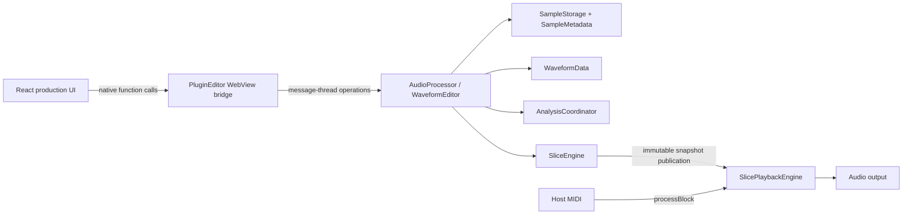

# UI-v2 — Bridge Integration Contract

Статус: проектный контракт для UI-2.1A. Это описание целевого протокола, а не реализация. Оно фиксирует фактические возможности текущего кода и отделяет их от предлагаемых изменений. До подключения UI-v2 старый production UI и его bridge остаются рабочим fallback.

## 1. Текущая архитектура и ограничения

### Фактический путь данных



`SampleStorage` — immutable shared audio storage. `WaveformData` содержит multiresolution min/max peaks по всем каналам; он строится при импорте вне audio thread. `SliceEngine` — изменяемая message-thread модель. `SlicePlaybackSnapshot` строится на control/message thread и публикуется для audio thread через существующую atomic-pointer/SPSC-retirement схему. MIDI slice voices обрабатываются в `processBlock()`; React в этот путь не входит.

В `src/plugin/PluginEditor.cpp` зарегистрированы native functions: `getState`, `selectSlice`, `editParameter`, `importSample`, `playSample`, `stopSample`, `splitSlice`, `resetSlices`, `deleteSlice`. Frontend `web-ui/src/nativeBridge.ts` вызывает их через JUCE `__juce__invoke` и получает completion через `__juce__complete`. Это request/response путь. В редакторе не обнаружена регистрация push-событий для отправки нативных обновлений во frontend; production UI опрашивает `getState` каждые 700 мс.

`getState` возвращает не типизированный DTO, а сериализуемый объект состояния:

- `sampleLoaded`, `status`, `playing`, `file`, `duration`, `sampleRate`, `channels`;
- `selectedSliceId`, `analysisReady`, `bpm`, `key`, `transientCount`;
- `slices[]`: `id`, `start`, `end`, `note`, `volume`, `pan`, `pitch`, `attack`, `decay`, `sustain`, `release`;
- `peaks[]`: до 256 чисел, вычисленных как `max(abs(minimum), abs(maximum))` из первого канала.

Sample metadata в C++ содержит `fileName`, `filePath`, `sampleRate`, `channelCount`, `bitDepth`, `sampleCount`; WebView получает лишь имя, длительность, sample rate и число каналов. Sample ID и ревизия `SliceEngine` в DTO отсутствуют. Sample ID генерируется `AnalysisCoordinator`, но не сериализуется. `SliceId` и ревизия в C++ — 64-битные целые; передавать их в JSON как JavaScript `number` небезопасно для всего диапазона, поэтому контракт ниже использует десятичные строки.

### Реальные возможности старого bridge

| Возможность | Сейчас в коде | Ограничение |
|---|---|---|
| Получить состояние | `getState()` возвращает полный текущий state | Нет версии схемы, sample identity/revision, typed result или push-событий; запросы frontend могут завершиться не по порядку |
| Sample import | `importSample()` открывает file chooser; загрузка идёт асинхронно | Completion вызывается сразу после открытия chooser и не подтверждает завершение импорта. Результат позже виден только в очередном `getState()` |
| Metadata | Имя, duration, sample rate, channel count | Нет `sampleId`, `sampleCount`, `bitDepth`, явного состояния import/error |
| Waveform | До 256 амплитудных значений первого канала | Потеряны channel separation и min/max; нет выбора LOD по ширине/zoom; повторная сериализация идёт при каждом polling |
| BPM / Key | В завершённом analysis result сериализуются BPM effective value и key name | UI видит только `analysisReady`; нет running/failed/cancelled, confidence, generation и ошибок |
| Transients | Передаётся только `transientCount` | Позиции, strength, confidence недоступны WebView; native WaveformEditor рисует реальные маркеры отдельно |
| Slice state | Границы в samples и все параметры сериализуются; порядок следует из массива | Нет sample identity/revision. `selectedSliceId` хранится в `WaveformEditorComponent`, а не `SliceEngine` |
| Slice selection | `selectSlice(id)` меняет native selection и возвращает полный state | В UI-v2 selection логичнее локально оставить React state; не использовать native editor selection как источник аудиосостояния |
| Slice mutations | split/delete/reset выполняются через выбранный ID внутри native WaveformEditor; `editParameter(id,name,value)` принимает только `volume` и `pan` | Split/delete зависят от неявного selection; нет expected sample/revision, targeted slice ID для структурных операций и структурированных ошибок. Pitch/ADSR только читаются старым bridge |
| Sample playback | `playSample()` и `stopSample()` управляют обычным Sample playback; `playbackPositionSeconds()` доступен процессору | Position не включена в `getState`; старый UI рисует фиктивную позицию |
| Slice playback | Host MIDI запускает до 16 SliceVoice; Note On/Off и voice stealing oldest реализованы | WebView-команда запуска выбранного слайса отсутствует. `playSample` — не запуск Slice. Доступен только atomic voice count, нет списка active Slice IDs/voice cursors |
| Master volume | APVTS `volume`, native slider attachment и processor control существуют | Старый WebView показывает статическое `MASTER 0.0 dB`; bridge-команды master volume нет |

У `getState()` поле `playing` означает объединённое состояние: обычный sample играет **или** активен хотя бы один slice voice. Это недостаточно, чтобы отличить transport Sample от MIDI-полифонии. `status` сейчас является строкой статуса импорта, а не enum состояния приложения. При неподдерживаемой команде или ошибочных аргументах completion всё равно возвращает очередной полный state; единообразного отказа нет.

### UI-v2 сегодня

`web-ui/src-v2/app/App.tsx` использует `demoData.ts`; `Waveform`, `Inspector`, `Transport` получают typed demo props. Playhead двигается через `requestAnimationFrame`, play/stop — локальная демонстрация. Компоненты не импортируют native bridge и не должны подключаться к нему на этапе UI-2.1A. DTO нового протокола не следует подменять demo types до отдельной интеграционной фазы.

## 2. Модель владения состоянием

| Область | Источник истины | Локальное состояние React |
|---|---|---|
| Sample identity, metadata, импорт и ошибки | C++ | Только представление loading/notification, если оно не противоречит последнему подтверждённому состоянию |
| Slice collection, границы, параметры и revision | C++ `SliceEngine` | Кэш последнего подтверждённого snapshot; временный draft значения во время drag разрешён только как optimistic preview и откатывается при отказе |
| Анализ и его generation | C++ `AnalysisCoordinator` | Нет отдельного результата анализа; UI лишь форматирует значения и статусы |
| Sample transport и позиция | C++ playback engine | Нет самостоятельного музыкального курсора; можно локально сгладить отображение между редкими native position updates, не отправляя его обратно как истину |
| Активные MIDI voices | C++ `SlicePlaybackEngine` | Только представление списка/индикаторов, если native слой предоставит telemetry |
| Выбранный slice в новом UI, открытые области, hover, gesture draft | React | Да. Selection — UI state, не параметр DSP. При смене `sampleId` React сбрасывает selection или выбирает валидный ID из нового snapshot |
| Демонстрационные данные | Текущая изолированная demo страница | Остаются независимыми до UI-2.1B+ |

React не должен поддерживать собственную редактируемую копию `SliceEngine`. Для команды редактирования он отправляет patch и хранит requestId как pending; controls показывают подтверждённое native значение. Во время частых изменений одного контрола допускается локальный draft, но ответ применяется только если относится к последнему запросу данного контрола и к тому же sample. Следующее подтверждённое состояние всегда заменяет draft.

## 3. Wire conventions и типы

Предлагаемый протокол — JSON-friendly TypeScript контракт поверх существующего JUCE native-function request/completion механизма. Это не утверждение о готовом JUCE API для server push. Доставка нативных событий в WebView должна быть отдельно подтверждена по JUCE 8 API; пока её нет, можно начать с запросов по событию и редкого bounded polling для transport.

### Общие правила

- `protocolVersion` обязателен в handshake, командах, ответах и событиях; текущая целевая версия — `2`.
- `requestId` — UUID или уникальная строка клиента в пределах жизненного цикла WebView; ответ эхо-повторяет его.
- Все `sampleId`, `sliceId`, `revision`, analysis `generation`, event `sequence` передаются десятичными строками. Не кодировать 64-битные значения как JS `number`.
- `expectedSampleId` обязателен для команд, адресующих загруженный sample/slice. `expectedRevision` обязателен для mutating-команд Slice. Revision проверяется до изменения; mismatch даёт `STALE_REVISION`, не тихий успех.
- Ответ команды — узкий `ack` с результатом и, при изменении, актуальным revision/затронутым ID. Не возвращать полную waveform и полный application state после каждого edit.
- Значения параметров и sample positions валидируются на C++ стороне по существующим доменным ограничениям. UI validation — только UX, не security boundary.
- Позиции слайсов и transient positions — целые sample-domain координаты; slice interval всегда `[startSample, endSample)`.
- Изменение sample создаёт новый `sampleId` даже при повторном открытии того же пути; это соответствует `AnalysisCoordinator::createSampleId()`.

### Общие TypeScript-типы

```ts
type Id64 = string; // unsigned decimal; JSON-safe
type SampleId = Id64;
type SliceId = Id64;
type Revision = Id64;
type RequestId = string;
type ProtocolVersion = 2;

type Envelope = { protocolVersion: ProtocolVersion };

type BridgeErrorCode =
  | 'UNSUPPORTED_PROTOCOL' | 'INVALID_ARGUMENT' | 'NO_SAMPLE'
  | 'STALE_SAMPLE' | 'STALE_REVISION' | 'NOT_FOUND'
  | 'INVALID_RANGE' | 'INVALID_PARAMETER' | 'BUSY'
  | 'IMPORT_FAILED' | 'ANALYSIS_FAILED' | 'INTERNAL';

type BridgeError = {
  code: BridgeErrorCode;
  message: string; // human-readable; UI must branch on code, not text
  retryable: boolean;
  details?: Record<string, string | number | boolean | null>;
};

type CommandAck<T> = Envelope & {
  type: 'ack'; requestId: RequestId; ok: true; result: T;
} | Envelope & {
  type: 'ack'; requestId: RequestId; ok: false; error: BridgeError;
};
```

В production C++ должен проверять JSON type/shape, диапазон строковых ID до преобразования в `uint64_t`, enum и конечность float-значений. Неизвестная версия/команда возвращает структурированную ошибку, а не пустой state.

### Snapshot состояния

```ts
type SampleMetadataDto = {
  id: SampleId;
  revision: Revision; // revision metadata/content for this loaded sample
  fileName: string;
  durationSeconds: number;
  sampleRate: number;
  sampleCount: number;
  channelCount: number;
  bitDepth: number | null;
};

type SliceParametersDto = {
  volume: number;              // current C++ range 0..2
  pan: number;                 // -1..1
  pitchSemitones: number;      // -24..24
  envelope: {
    attackSeconds: number;     // 0..10
    decaySeconds: number;      // 0..10
    sustainLevel: number;      // 0..1
    releaseSeconds: number;    // 0..10
  };
};

type SliceDto = {
  id: SliceId;
  startSample: number;         // non-negative safe integer within sampleCount
  endSample: number;           // exclusive; > startSample
  midiNote: number;            // 0..127
  parameters: SliceParametersDto;
};

type AnalysisStatusDto = 'notAnalyzed' | 'running' | 'completed' | 'failed' | 'cancelled';
type AnalysisDto = {
  sampleId: SampleId;
  generation: Revision;
  status: AnalysisStatusDto;
  bpm: null | { value: number | null; confidence: number; score: number; detectionStatus: string };
  key: null | { tonic: string | null; mode: 'major' | 'minor' | null; confidence: number; score: number; detectionStatus: string };
  transients: null | {
    sampleRate: number;
    sampleCount: number;
    totalEventCount: number;
    truncated: boolean;
    positions: Array<{ samplePosition: number; strength: number; confidence: number | null }>;
  };
  error: string | null;
};

type NativeSnapshot = Envelope & {
  type: 'snapshot';
  sequence: Revision;
  app: { status: 'ready' | 'loading' | 'error'; message: string | null };
  sample: SampleMetadataDto | null;
  sliceRevision: Revision | null;
  slices: SliceDto[];
  analysis: AnalysisDto | null;
  sampleTransport: {
    status: 'stopped' | 'playing';
    positionSamples: number;
  } | null;
  activeVoices: ActiveVoiceDto[] | null; // null until native voice telemetry exists
};

type ActiveVoiceDto = {
  voiceId: string; sliceId: SliceId; midiNote: number;
  velocity: number; startedAtFrame: string;
};
```

`sample.revision` здесь — version конкретного загруженного asset/metadata; `sliceRevision` — `SliceEngine::revision()`. Их нельзя смешивать. Для consistency проверки `sample.id` связывает Slice, analysis, waveform и команды. `sequence` монотонно нумерует опубликованные snapshot/events в рамках WebView session, чтобы отбрасывать запоздавшие ответы. Позиции как JS number допустимы только если проверяются на safe integer; альтернатива — decimal string, если будущие файлы смогут превысить `Number.MAX_SAFE_INTEGER`.

### Waveform — отдельный запрос с ограниченным объёмом

Не включать все peaks в каждый `NativeSnapshot`. При загрузке sample UI запрашивает waveform для выбранного display width/LOD; C++ выбирает multiresolution level и возвращает ограниченный массив min/max отдельно по каналу. Это summary, не PCM.

```ts
type WaveformRequest = Envelope & {
  type: 'getWaveform'; requestId: RequestId; sampleId: SampleId;
  maxBuckets: number; // bounded by native, e.g. UI asks for visible CSS width × DPR
};

type WaveformDto = Envelope & {
  type: 'waveform'; requestId: RequestId; sampleId: SampleId;
  framesPerPeak: number;
  channels: Array<Array<{ min: number; max: number }>>;
};
```

Для первой реализации ограничить число bucket-ов на канал согласованным лимитом, например 2,048, и запрашивать заново только при смене sample или реально изменившемся LOD/ширине. Точное значение выбрать по измерению payload и Canvas; не сериализовать заново на каждом UI poll. Если полный JSON payload окажется тяжёлым, вводить paging/chunking только после замера — не передавать PCM и не строить waveform в audio callback. Текущий C++ `WaveformData` уже содержит per-channel min/max levels, но существующий bridge это преимущество теряет.

## 4. Предлагаемые команды React → C++

Все команды имеют `protocolVersion`, `requestId`, `type`. Текущий JUCE bridge принимает positional arguments и не реализует эти envelopes; в отдельном UI-v2 bridge handler потребуется явная декодировка и валидация.

```ts
type BridgeCommand =
  | (Envelope & { type: 'getSnapshot'; requestId: RequestId })
  | WaveformRequest
  | (Envelope & { type: 'setSliceParameter'; requestId: RequestId;
      sampleId: SampleId; expectedRevision: Revision; sliceId: SliceId;
      patch: Partial<SliceParametersDto> })
  | (Envelope & { type: 'splitSlice'; requestId: RequestId;
      sampleId: SampleId; expectedRevision: Revision; sliceId: SliceId; atSample: number })
  | (Envelope & { type: 'deleteSlice'; requestId: RequestId;
      sampleId: SampleId; expectedRevision: Revision; sliceId: SliceId })
  | (Envelope & { type: 'resetSlices'; requestId: RequestId;
      sampleId: SampleId; expectedRevision: Revision })
  | (Envelope & { type: 'importSample'; requestId: RequestId });
```

Пример изменения одного параметра:

```json
{
  "protocolVersion": 2,
  "type": "setSliceParameter",
  "requestId": "ui-42",
  "sampleId": "918273645001",
  "expectedRevision": "12",
  "sliceId": "7",
  "patch": { "volume": 0.82 }
}
```

Пример успешного подтверждения содержит только затронутую сущность либо новое значение и актуальный revision:

```json
{
  "protocolVersion": 2,
  "type": "ack",
  "requestId": "ui-42",
  "ok": true,
  "result": { "sampleId": "918273645001", "sliceRevision": "13", "sliceId": "7", "parameters": { "volume": 0.82 } }
}
```

Ошибочный revision должен вернуть `ok:false`, `error.code:'STALE_REVISION'` и, по возможности, актуальный revision в `details`; UI получает свежий snapshot и не повторяет мутацию молча. `setSliceParameter` должен поддерживать поля текущего `SliceParameters` (Volume, Pan, Pitch и A/D/S/R), валидировать весь patch до применения и обновлять одну slice model без сброса других полей. Каждая accepted мутация приводит к построению/публикации immutable `SlicePlaybackSnapshot` существующим процессорным механизмом; уже звучащий voice продолжает использовать параметры snapshot, захваченные при старте.

`splitSlice` адресует конкретный slice и sample-domain `atSample`; `deleteSlice` не полагается на выбор native editor. Для reset лучше либо использовать отдельную команду с явно документированной семантикой `SliceEngine::resetSlices()`, либо добавить подтверждение, если reset destructive. Текущая реализация UI split midpoint может отправлять середину из подтверждённых start/end. Добавлять команду запуска slice через bridge в этой фазе не рекомендуется: текущий WebView API её не предоставляет, а SlicePlaybackEngine запускает слайсы через host MIDI.

Для `importSample` completion означает только «команда принята / file chooser открыт», а не успешный импорт. Фактический результат приходит последующим snapshot/event с новым `sampleId` или structured import error. Путь к файлу не передавать из React без отдельного требования; сейчас native file chooser владеет выбором файла.

## 5. Предлагаемые события C++ → React

```ts
type NativeEvent =
  | (Envelope & { type: 'stateSnapshot'; sequence: Revision; state: NativeSnapshot })
  | (Envelope & { type: 'stateChanged'; sequence: Revision; sampleId: SampleId | null;
      sliceRevision?: Revision; changed: Array<'sample' | 'slices' | 'analysis' | 'transport' | 'voices'> })
  | (Envelope & { type: 'importCompleted'; sequence: Revision; sampleId: SampleId })
  | (Envelope & { type: 'operationFailed'; sequence: Revision; requestId: RequestId; error: BridgeError })
  | (Envelope & { type: 'transportUpdate'; sequence: Revision; sampleId: SampleId;
      status: 'stopped' | 'playing'; positionSamples: number })
  | (Envelope & { type: 'voiceUpdate'; sequence: Revision; sampleId: SampleId;
      activeVoices: ActiveVoiceDto[] });
```

Snapshot нужен для initial handshake, sample replacement, WebView reload/reopen и восстановления после ошибки/sequence gap. Обычные edits должны отправлять небольшое изменение/ack или уведомление «состояние изменилось», после которого UI получает актуальные Slice DTO. Не отправлять весь snapshot и waveform на каждый slider tick.

Native → WebView доставка в текущем `PluginEditor.cpp` не реализована. Перед этапом событий нужно проверить JUCE 8 поддерживаемый вызов/контекст отправки в конкретной версии и поведение при закрытой/пересозданной странице. До этого безопасный минимальный fallback — response на запросы плюс message-thread timer для ограниченно частого transport status, но не 700ms полный waveform snapshot.

## 6. Stale-команды, ошибки и согласование UI

1. При готовности страницы React отправляет `getSnapshot`. Backend возвращает `protocolVersion`, initial state и session sequence. Несовпадающий major version — явная ошибка, не пустое состояние.
2. Все команды выполняются в message-thread/control context. Handler проверяет sample ID, expected revision, slice ID, finite/range constraints и допустимость операции до изменения модели.
3. При смене Sample прежние IDs становятся stale. C++ отклоняет старые команды; React сбрасывает selection/draft и привязывает новый snapshot к новому sample ID.
4. Ответ применяется только если совпадает requestId, sampleId и не старше уже принятого sequence/revision. Старый ответ не может перезаписать новый state. Для одного контрола быстрые команды могут коалесцироваться на frontend; backend не должен принимать изменения в неверном порядке.
5. Ошибка имеет стабильный машинный code и текст для человека. Не преобразовывать transport offline, malformed response или timeout в валидный «sample отсутствует».
6. Добавить ограниченный timeout и cleanup pending promises при уничтожении/перезагрузке frontend. Текущий `nativeBridge.ts` не устанавливает timeout и не имеет очистки pending map; следует исправить в отдельном bridge этапе.
7. UI selection в UI-v2 остаётся React-owned. Для команд редактирования всегда явно передаются `sampleId` и `sliceId`; C++ selection state не требуется для audio. После split/delete/reset React сверяет выбранный ID с новым подтверждённым slice list и выбирает fallback по заранее принятому UX правилу.

## 7. Realtime safety

- Native function callbacks, JSON parsing/serialization, файловый chooser, анализ, waveform extraction и любые WebView operations выполняются не из `processBlock()`; они должны работать в message/control/background context согласно конкретной задаче.
- Ни JavaScript, ни WebView callback не вызываются из audio thread. Не добавлять mutex для связи UI с audio callback.
- Audio thread продолжает читать только уже опубликованные immutable snapshot и lock-free/atomic playback controls. Изменение slice-модели и подготовка snapshot остаются control thread задачей; это совпадает с текущей моделью processor/editor.
- Анализ продолжает использовать `AnalysisCoordinator` worker и его sample/generation stale-result protection. Bridge только читает/публикует готовый status/result; не запускает анализ из audio thread.
- Waveform берётся из уже подготовленного `WaveformData`; ограничение количества buckets задаётся при запросе. Не копировать `SampleStorage`/PCM в React и не передавать аудиобуферы через JSON.
- Transport telemetry публикуется редкими bounded сообщениями (ориентир 15–30 updates/s только пока играет), коалесцируется и никогда не меняет DSP. Частоту зафиксировать по визуальному результату/CPU профилю.
- Lifecycle WebView отделён от аудио: закрытие/перезагрузка страницы не должно останавливать voices, освобождать snapshot из audio thread или менять sample.

## 8. Playback и multi-voice semantics

Развести три понятия:

1. `sampleTransport`: позиция обычного Sample playback (`SamplePlaybackEngine::positionSeconds()` уже существует, но в старый bridge не выведена). Единственный playhead допустим для этого транспорта.
2. `selectedSliceId`: slice, который инспектор показывает и который локально выбрал пользователь. Это не означает, что он звучит.
3. `activeVoices`: ноль или несколько голосов, начатых MIDI Note On. Один MIDI note может соответствовать нескольким slice regions с той же note. Каждый voice связан со своим `sliceId`, note и velocity; MIDI Note Off освобождает все активные voices с соответствующей назначенной нотой. Лимит engine — 16; при нехватке voice слот переиспользуется по oldest start frame.

Сейчас `SlicePlaybackEngine` публикует только atomic `activeVoiceCount()`, а `SliceVoice` знает свой snapshot/region/note/velocity/start frame внутри engine. Bridge не может достоверно сформировать `activeVoices[]` или отдельные playheads без дополнительной безопасной telemetry API. Это реальный gap; не выводить active slice из выбранного ID и не рисовать один общий playhead для поли-фонии. Для первого UI подключения достаточно визуально показывать только sample transport; отдельный этап решит, нужен ли компактный счётчик активных голосов или фиксированный read-only voice telemetry buffer.

`stopSample()` в текущем Processor останавливает Sample playback и просит slice voices остановиться через atomic stop request. Это не то же самое, что MIDI Note Off одного голоса. Протокол должен иметь разные типы управления, если в будущем появится UI-triggered audition.

## 9. Этапы интеграции

Старый production UI остаётся fallback, пока новые этапы не пройдут функциональные проверки. Для каждого этапа bridge DTO и React view model тестируются отдельно от DSP; аудио модели не переписываются без доказанной необходимости.

| Этап | C++ / bridge | React | Сообщения | Критерии и проверки |
|---|---|---|---|---|
| **UI-2.1B — protocol shell & handshake** | Добавить отдельный versioned handler, validator, typed ack/error и snapshot из message-thread state. Не ломать старые native function names/аргументы | Новый bridge adapter и parser/reducer вне demo types; старый экран доступен | `getSnapshot`, `ack`, `stateSnapshot` | Parser tests для валидных/невалидных DTO, несовпавшей версии, malformed payload; оба интерфейса собираются, старый bridge smoke test |
| **UI-2.1C — Sample metadata & lifecycle** | Публиковать sampleId, metadata, loading/ready/error и новую identity на каждую загрузку; import completion отдельно от chooser ack | Header, Empty/Loading/Error, sample identity reset | `importSample`, `getSnapshot`, `importCompleted`, `operationFailed` | Async success/failure/cancel, повторная загрузка того же файла, WebView reload; старый response не подменяет текущий sample |
| **UI-2.1D — Waveform & analysis** | Запрос per-channel min/max LOD из `WaveformData`; публиковать analysis status/result и transient positions для matching sampleId/generation | Waveform Canvas, rulers, transient layer, metadata analysis | `getWaveform`, waveform DTO; snapshot/event analysis | Проверить mono/stereo, sample change, max payload, sample positions mapping, stale analysis generation, truncated transients; не копировать PCM |
| **UI-2.1E — Slice state & selection** | Экспортировать stable IDs, `[start,end)`, parameters, sliceRevision; добавить selection-independent DTO | Waveform slice layers, sequence, Inspector; React-owned selection | `getSnapshot`, `stateChanged` | Пусто/один/плотные slices, ID precision, смена sample, selection согласуется во всех компонентах; boundaries unit tests |
| **UI-2.1F — Slice parameter edits** | Явные `sliceId`, sampleId, expectedRevision; C++ validate patch и publish snapshot через текущий процессорный путь | Editable Volume/Pan/Pitch/ADSR; confirmed value + pending draft | `setSliceParameter`, `ack`, `operationFailed` | Все диапазоны, NaN/Infinity, stale revision/sample, неизвестный slice, быстрые последовательные edits; неизменность остальных полей; уже звучащий voice не меняет параметры |
| **UI-2.1G — Structural slice commands** | Явные split target/position, delete target и reset; ошибки и новый revision | Split/Delete/Reset и selection fallback | `splitSlice`, `deleteSlice`, `resetSlices`, `stateChanged` | Min slice length, boundaries, invalid range, stale IDs, delete selected/non-selected, reset/empty; snapshot реально обновлён |
| **UI-2.1H — Analysis & transport** | Полный AnalysisResult status, Sample playback position/status; определить решение voice telemetry отдельно | Analysis UI, Transport/playhead, selected vs active language | snapshot, `transportUpdate`, optional `voiceUpdate` | Position monotonic/reset/end/sample replacement, rate bounded; не путать Sample play с MIDI slice voices; если voice telemetry не готова — UI честно не показывает фиктивную активность |
| **UI-2.1I — lifecycle, parity & fallback decision** | Проверить page-ready/reload/close, cleanup callbacks, schema compatibility, event coalescing | Offline/error recovery, reconnection, visual polish | `getSnapshot`, all acks/events | Reopen editor, reload frontend, pending commands, sequence gap, import during page reload; compare parity и оставить fallback до отдельного принятия решения |

## 10. Открытые решения

| Решение | Рекомендация | Когда утвердить |
|---|---|---|
| Native → WebView event delivery для JUCE 8 | Перед реализацией проверить точный API установленной версии, message-thread requirement, delivery после reload/visibility. Не считать `withEventListener` автоматически готовым push каналом | UI-2.1B |
| Revision scope | Оставить sample identity, SliceEngine revision и analysis generation отдельными полями; глобальный `sequence` использовать только для упорядочивания UI messages | UI-2.1B |
| 64-bit IDs в JSON | Передавать decimal strings; парсить/проверять в C++; sample positions оставить number только с safe-integer проверкой | UI-2.1B |
| Waveform payload cap / LOD | Запрос per-channel min/max с лимитом bucket-ов; определить точный максимум по WebView payload and Canvas measurements, не на глаз | UI-2.1D |
| Selection ownership | Для UI-v2 — React-owned ephemeral selection; не добавлять selection в audio snapshot. Если native components ещё используются за WebView, старому UI оставить свой selection отдельно | UI-2.1E |
| Playback visualization для полифонии | В первой версии рисовать playhead только обычного Sample transport. Active voice indicators — лишь после безопасной per-voice telemetry; не создавать cursor одной позиции для разных voices | UI-2.1H |
| UI slice audition | Не включать в этот контракт как готовую команду: сейчас триггер — Host MIDI; отдельное решение нужно о note-on/off ownership, duplicate-note semantics и release lifecycle | До возможной фазы MIDI audition |
| `importSample` completion | Разделить command accepted/file chooser open и реальный import outcome event/snapshot | UI-2.1C |
| Master Volume | Добавить команду только если новый UI должен реально редактировать APVTS `volume`; масштаб/единицы UI (linear vs dB) определить с существующей параметризацией | UI-2.1H или отдельный параметрический этап |
| Удаление старого fallback | Не удалять и не переключать production default до функционального parity, ручной Standalone smoke test и проверки plugin-host lifecycle | После UI-2.1I, отдельное решение |

## Итог готовности

Для дизайна UI-v2 существующие C++ доменные модели достаточны: не требуется переписывать SampleStorage, SliceEngine, AnalysisCoordinator или DSP. Но bridge не готов к прямому подключению нового UI: нужны versioned DTO/acks/errors, sample identity/revision, per-channel waveform query, analysis statuses/transient events, stale-safe targeted edits и lifecycle handling. Transport position уже доступна на Processor API, но не выведена; per-voice list отсутствует и потребует отдельной безопасной telemetry до отображения active Slice. Старый bridge следует сохранить без несовместимых изменений, пока новый путь не пройдёт проверки.
